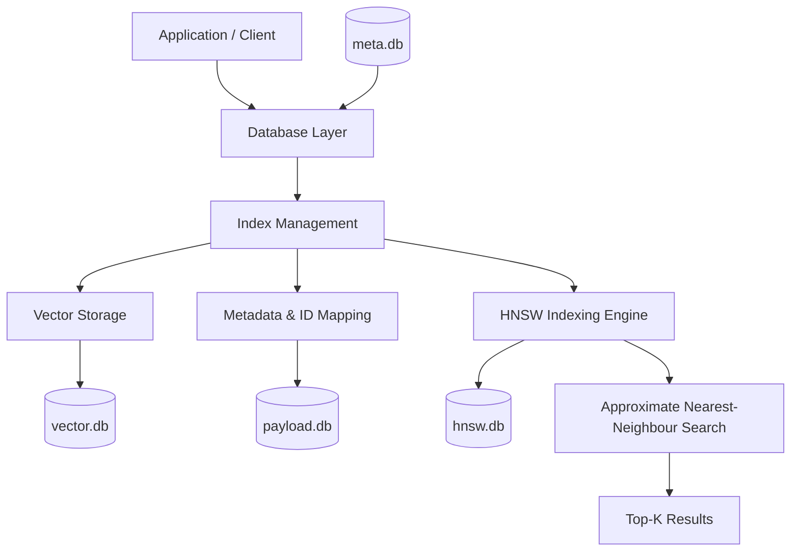
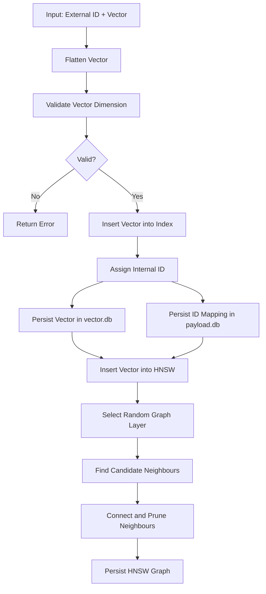
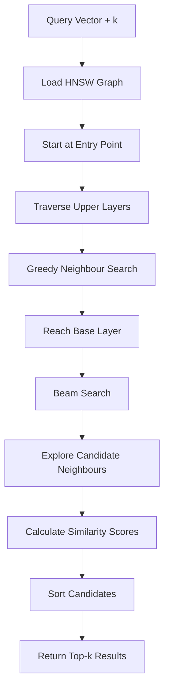

# Save Vector

A lightweight vector storage and approximate nearest-neighbour search prototype written in Go, using the Hierarchical Navigable Small World (HNSW) algorithm.

## Overview

Save Vector is an experimental vector storage engine designed to store fixed-dimensional `float32` vectors on disk and retrieve similar vectors using graph-based approximate nearest-neighbour search.

It explores two core problems:

- **Vector persistence:** storing vector data and mapping application-level identifiers to internal vector IDs.
- **Similarity search:** organising vectors into an HNSW graph to retrieve nearby vectors efficiently.

## Architecture

Save Vector separates database management, vector storage, metadata handling and graph-based indexing into distinct components.



### Component responsibilities

| Component | Responsibility |
|---|---|
| `models/` | Database and index creation, vector persistence, metadata and ID lookup |
| `indexing/` | HNSW graph construction, neighbour selection and nearest-neighbour search |
| `utils/` | Vector flattening, binary conversion and logging |
| `config/` | Storage file names and metadata configuration |
| `proto_models/` | Protocol Buffer metadata definitions |

## Storage Layout

Creating a database and an index produces a directory structure similar to:

```text
mydb/
├── meta.db
└── products/
    ├── vector.db
    ├── payload.db
    └── hnsw.db
```

| File | Purpose |
|---|---|
| `meta.db` | Database metadata, including its name, timestamps and index names |
| `vector.db` | Raw vector values stored as binary `float32` data |
| `payload.db` | Index metadata and external-to-internal ID mapping |
| `hnsw.db` | Serialised HNSW graph, including nodes, layers and neighbour relationships |

Database metadata is serialised using Protocol Buffers. Vector values and graph metadata use binary representations with little-endian encoding.

## Vector Insertion Workflow

The insertion process coordinates vector persistence and graph indexing.



### Insertion steps

1. `Index.InsertVector(externalID, vector)` validates and persists the vector, then records its external ID.
2. The internal ID is obtained from the index count after insertion.
3. `HNSW.InsertVector(index, internalID, vector)` registers the vector in the HNSW graph.
4. The graph selects candidate neighbours and updates its connections.

**Important:** These are separate operations. Both must succeed to keep vector storage and graph indexing consistent. The example in `main.go` demonstrates this using the `insertFull` helper.

## HNSW Search Workflow

HNSW organises vectors into a hierarchy of graph layers. Upper layers provide long-range navigation, while the base layer contains more detailed neighbourhood connections.



### How search works

1. Start from the graph entry point.
2. Traverse upper layers using greedy search.
3. Move to the next lower layer using the best available candidate.
4. Explore candidates at the base layer using beam search.
5. Sort candidates by similarity score.
6. Return up to `k` results containing internal IDs and scores.

HNSW provides approximate nearest-neighbour search. It does not guarantee that every returned result is the exact nearest neighbour.

## HNSW Parameters

The constructor is:

```go
h := indexing.NewHNSW(M, efConstruction, efSearch)
```

| Parameter | Description |
|---|---|
| `M` | Controls the maximum neighbour count. The implementation allows up to `2*M` neighbours at layer 0 and `M` at higher layers. |
| `efConstruction` | Controls candidate exploration width during graph insertion. |
| `efSearch` | Controls candidate exploration width during search. |

Increasing exploration widths can improve search quality, but may increase computational cost.

## Usage

### Create a database and index

```go
db, err := models.CreateDatabase("mydb")
if err != nil {
    log.Fatal(err)
}

idx, err := db.CreateIndex("products", 128)
if err != nil {
    log.Fatal(err)
}
```

The index is configured for vectors containing 128 dimensions.

### Initialise HNSW

```go
h := indexing.NewHNSW(
    16,  // M
    200, // efConstruction
    50,  // efSearch
)
```

### Insert a vector

```go
vector := make([]float32, 128)

if err := idx.InsertVector("doc-001", vector); err != nil {
    log.Fatal(err)
}

internalID := idx.Count() - 1

if err := h.InsertVector(idx, internalID, vector); err != nil {
    log.Fatal(err)
}
```

The vector must have the same dimension as the index.

### Search for similar vectors

```go
query := make([]float32, 128)

results, err := h.KNNSearch(idx, query, 3)
if err != nil {
    log.Fatal(err)
}

for rank, result := range results {
    fmt.Printf(
        "#%d internalID=%d score=%.4f\n",
        rank+1,
        result.InternalID,
        result.Score,
    )
}
```

The search returns up to three candidate results, each containing an internal vector ID and a similarity score.

### Search using an external ID

```go
results, err := h.KNNSearchByExternalID(
    idx,
    "doc-001",
    3,
)
if err != nil {
    log.Fatal(err)
}
```

This helper is intended to resolve an external ID, retrieve its vector and use that vector as the search query. Verify the current external-ID lookup implementation before relying on this workflow.

## Similarity Scoring

The current implementation uses a dot-product calculation in its `cosineSim` helper:

```go
func cosineSim(a, b []float32) float32 {
    var dot float32

    for i := range a {
        dot += a[i] * b[i]
    }

    return dot
}
```

Despite the helper's name, this function does not calculate normalised cosine similarity. Its output is a dot-product score.

For genuine cosine similarity, vectors need to be normalised or the calculation must divide the dot product by the product of the vector magnitudes.

## Current Scope and Limitations

Save Vector is an experimental implementation, not a production-ready vector database.

Known limitations include:

- The current search score is a dot product, not mathematically normalised cosine similarity.
- Vector insertion and HNSW graph insertion are separate operations and must both succeed to keep the stores consistent.
- A complete update and deletion workflow is not demonstrated.
- Search results expose internal IDs; a complete application workflow would also resolve these IDs to external identifiers.
- The implementation loads stored vectors into memory during HNSW insertion and search, which may become expensive as the dataset grows.
- Production use would require stronger error handling, persistence consistency, concurrency controls, validation and recovery mechanisms.

## Future Improvements

- Implement normalised cosine similarity as an explicit scoring option.
- Add vector update and deletion support.
- Improve external-ID lookup and result resolution.
- Reduce repeated disk reads and full-vector loading.
- Add automated correctness, recall and performance benchmarks.
- Improve recovery and consistency when vector storage and graph insertion fail independently.
- Add concurrency-safe insertion and search operations.

## Project Structure

```text
Save-vector/
├── config/
│   └── config.go
├── indexing/
│   ├── heap.go
│   └── hnsw.go
├── models/
│   ├── database.go
│   ├── databaseCreate.go
│   ├── databaseFetch.go
│   ├── index.go
│   ├── indexCreate.go
│   ├── indexFetch.go
│   ├── indexServices.go
│   ├── indexVectorInsert.go
│   └── vector.go
├── proto_models/
│   ├── db_meta.proto
│   └── db_meta.pb.go
├── utils/
│   ├── index.go
│   ├── logger.go
│   └── vector.go
├── main.go
├── go.mod
└── go.sum
```

## Technology Stack

- **Language:** Go
- **Search algorithm:** Hierarchical Navigable Small World (HNSW)
- **Vector representation:** `float32`
- **Persistence:** Binary file storage
- **Metadata serialisation:** Protocol Buffers

## Learning Outcomes

- Implementing graph-based approximate nearest-neighbour search.
- Designing a multi-layer HNSW graph.
- Persisting vectors and metadata using binary file operations.
- Mapping external identifiers to internal storage identifiers.
- Separating storage responsibilities from indexing and search logic.
- Understanding trade-offs between search quality, exploration width and computational cost.


